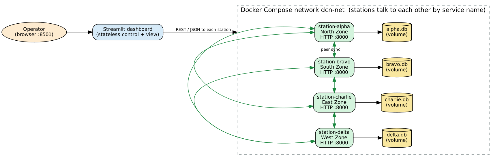

# Disaster-Resilient Distributed Incident Coordination Network
**A Dockerized, Offline-Capable Distributed System for Emergency Incident Reporting and Resource Coordination**

Course: Distributed Systems — Mini Project · Educational prototype (not a production emergency system)

---

## 1. Problem statement

During floods, earthquakes and fires, communication infrastructure becomes unreliable. Field stations that lose contact with a central server must still record incidents and accept resource requests, and must reconcile their records once connectivity returns. A purely centralized application is unavailable to every disconnected station. This project builds a distributed system in which independent stations keep their own persistent state, exchange data with reachable peers, and **converge after partitions and node crashes**.

## 2. Objectives

1. Four independent station services, each owning a SQLite database in a persistent volume.
2. Local-first writes (incidents, resource requests) that keep working during partitions and crashes.
3. Real peer-to-peer synchronization over HTTP: idempotent, validated, atomic, deterministic merge.
4. Application-level partition simulation enforced by the networking code; crash/restart demonstration.
5. Observability: every number in the UI is derived from station databases and real events.
6. Repeatable scenarios (A–E), automated tests, one-command Docker deployment.

## 3. Architecture



| Component | Role |
|---|---|
| **Station** (`dcn/station.py`) ×4 | Independent process: HTTP API, validation, own SQLite DB, partition table, sync initiator/responder. |
| **Persistence** (`dcn/db.py`) | SQLite (WAL, `synchronous=FULL`); tables `records`, `sync_events`, `conflicts`, `peer_state`, `links`, `counters`; all writes in `BEGIN IMMEDIATE` transactions. |
| **Merge** (`dcn/merge.py`) | Pure deterministic comparison rule. |
| **Sync** (`dcn/sync.py`) | Summary exchange + push; outcome logging. |
| **HTTP client** (`dcn/netclient.py`) | `urllib` with explicit timeouts and bounded retries (network errors only). |
| **Dashboard** (`dashboard/`) | Stateless Streamlit control panel: reads station state on each run, writes only on explicit clicks. Holds no records. |
| **Docker Compose** | Dedicated network `dcn-net`, four named volumes, health checks, `restart: unless-stopped`; stations address each other by service name. |

Data model: a *record* (`incident` or `request`) has `id`, `kind`, `payload`, `version`, `updated_at`, `writer`, `origin`, `created_at`, `deleted` and a SHA-256-based `digest` over those fields. `origin` = station where it was created (→ UI "LOCAL" vs "REPLICATED").

## 4. Implementation highlights

* **Validation** (`dcn/schemas.py`): explicit enums (category, severity, resource type, priority, status), length/quantity bounds, request status transitions (pending → acknowledged → fulfilled/cancelled), JSON body size/Content-Type checks, and — for records arriving from peers — id/timestamp/node format checks **plus digest verification** (tampered or corrupted records are rejected and counted).
* **Local-first write path:** `POST /incidents` → validate → one SQLite transaction → `201`. No network access occurs.
* **Partition enforcement:** per-station `links` table. The initiator skips a blocked link (`skipped_partition`, no packet sent); the receiver rejects peer traffic from a blocked peer with `503 link_down` (`rejected_partition`). The dashboard configures both ends; either end suffices.
* **Failure observation:** `GET /peers` probes each peer: `reachable`, `partitioned` (station alive, link cut) or `unreachable` (connection refused/timeout → crashed/stopped).
* **Metrics:** pending ops = records whose current digest is not confirmed at a peer (`peer_state`); duplicates/stale/conflicts/invalid/messages are SQLite counters; success/failed/skipped and durations come from `sync_events`; convergence = equal fingerprints.

## 5. Distributed algorithms

### 5.1 Anti-entropy synchronization
1. `A → B  POST /sync/exchange {summary: id → [version, updated_at, writer, digest]}`
2. B diffs the summaries and replies `{send: records A lacks/has older, need: ids B lacks/has older}`.
3. A merges `send` in one atomic transaction.
4. `A → B  POST /sync/push {records: need}`; B validates and merges atomically, returning a per-record `applied | duplicate | stale`.

Properties: idempotent (re-delivery is a counted no-op), failure-atomic (a batch is all-or-nothing; a half-finished exchange is `partial` and repaired by the next one), order-independent.

### 5.2 Deterministic conflict resolution
Order key `(version, updated_at, writer, digest)`, larger wins:
1. higher **version** wins → an older update never overwrites a newer one;
2. equal version ⇒ **conflict** (concurrent updates); later `updated_at` wins;
3. equal timestamp ⇒ higher `writer` node id wins; 4. final tie ⇒ larger digest.

The order is total and identical on every node, hence merge is commutative, associative and idempotent. A unit test applies all 24 permutations of four competing copies and checks a single final state. **Tombstones** (`deleted=true`, normal versioned records) prevent resurrection of deleted records.

### 5.3 Failure detection
Timeouts (2 s, one retry) classify a peer as `unreachable`. This is inherently unreliable: it cannot distinguish a crash from a slow network. Partitions are distinguishable only because stations know their simulated link table.

## 6. Results (measured, not hand-written)

Source: `results/experiments.md` / `.json`, produced by `scripts/run_experiments.py --in-docker` against the **running Docker Compose stack** (4 stations + dashboard on one machine; see §7 for the environment).

**Scenarios A–E** (each resets, acts over HTTP, and verifies from station data): all five **passed**, 6/6, 7/7, 5/5, 10/10 and 6/6 verification steps, in 0.6–4.0 s (D includes stopping and starting a real container). They were also run by clicking the dashboard's scenario buttons in a real browser (A, B, C, E against local processes; D, which stops and starts a real container through the Docker socket, against the Docker stack — all steps passed, no UI errors).

**Synchronization time** (all 4 stations converge after N records are created at Alpha; median of 5 runs, 2 for N=250):

| Records | Median (ms) | Min–Max (ms) |
|---:|---:|---:|
| 1 | 572 | 513–685 |
| 10 | 613 | 501–639 |
| 50 | 690 | 574–799 |
| 100 | 750 | 686–755 |
| 250 | 890 | 767–1013 |

Time grows slowly with record count; most of the cost is the fixed set of sequential HTTP round trips plus fsync'd SQLite commits (`synchronous=FULL`). These are single-host numbers, not WAN figures.

**Partition recovery:** 20 incidents created at an isolated Alpha; while isolated, 12 sync attempts took place (Alpha's were skipped); after reconnecting, one `sync_network()` (2 rounds) converged all stations in ≈ 0.5 s.

**Node crash & restart (Bravo):** 10 records before the crash; stopped container detected unavailable immediately; 15 records created elsewhere meanwhile; the 6 sync attempts to Bravo during the outage all ended `unreachable` (not `skipped_partition`); after restart (healthy in ≈ 0.3 s) Bravo's volume still held its **10 records**; one catch-up sync (≈ 0.67 s) brought it to **25/25** and the network converged.

**Communication attempts (crash experiment):** 60 successful exchanges, 6 failed (`unreachable`), 0 skipped. Over the dashboard demo session additional `skipped_partition` and `unreachable` attempts are visible on page 7.

**Automated tests:** 45 tests pass (`python -m unittest discover -s tests -t .`): 20 unit tests (persistence, restart, validation, merge, duplicates, conflicts, tombstones, atomicity) and 25 integration tests with four real station processes (HTTP validation, sync, partition enforcement incl. remote rejection, recovery, SIGKILL restart, scenarios A–E and repeatability).

## 7. Verification environment and honesty notes

* Development/validation ran in a Linux sandbox with Python 3.13 and a Docker 29 engine. Docker Hub was **unreachable** from that sandbox, so `python:3.12-slim` could not be pulled; the real `Dockerfile` and `compose.yaml` were exercised by building from a **locally imported stand-in base image** (`BASE_IMAGE` build argument) containing Python 3.13 + Streamlit 1.40.2. Verified there: build, five healthy containers, service-name networking, named volumes persisting across `docker compose down`/`up`, `down -v` fresh deployment, container stop/start through the dashboard's Docker-socket controller, scenarios A–E and the screenshots in `docs/screenshots/`.
* **Not verified here:** Docker Desktop on Windows 11 itself, and the stock `python:3.12-slim` image. Nothing in the code is OS-specific, but if the socket mount behaves differently on your machine, the CLI commands in the README provide the same capability.
* Screenshots in `docs/screenshots/` are genuine captures from the running stack in that sandbox; replace them with your own captures when submitting.

## 8. Limitations

* **Eventual consistency only** — no consensus, strong consistency, transactions across stations, Byzantine tolerance or guaranteed delivery. Replicas differ until a sync runs (auto-sync is disabled by default for deterministic demos).
* **Last-writer-wins at record level:** the losing concurrent update is discarded (logged, not merged). Detection relies on equal integer versions and cannot establish concurrency in general (version vectors would). Node clock skew can influence the winner.
* Full-summary exchange costs O(records) per sync; full replication on every station.
* Partitions are simulated at the application layer (symmetric, on/off); no latency/loss/one-way faults.
* No authentication/encryption between stations; tombstones are never garbage-collected; the Docker-socket mount is a deliberate convenience with security implications.

## 9. Conclusion

The system demonstrates, with real independent processes and real HTTP, that stations can stay available during partitions and crashes, keep durable local state, and converge deterministically afterwards. Replication, idempotency, conflict resolution, failure detection and the availability/consistency trade-off are all observable and measurable in the dashboard, and the limitations are explicit. Natural extensions: version vectors or CRDT field merges, Merkle-tree delta sync, background gossip with a failure detector, mutual TLS and hybrid logical clocks.

## Appendix: reproduce

```powershell
docker compose up --build -d                                    # start (http://localhost:8501)
docker compose exec dashboard python scripts/run_experiments.py --in-docker   # regenerate results/
python -m unittest discover -s tests -t . -v                    # tests (no Docker needed)
```
